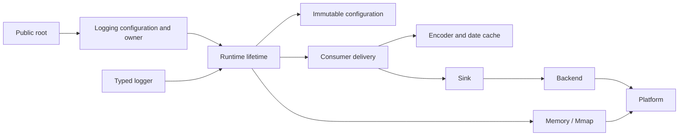

# Code structure and public boundaries

Application integration starts at `kron.Logging`; source exploration starts at
the grouped exports in [src/root.zig](../src/root.zig). The root module preserves
existing public names while internal file locations may be reorganized by
responsibility. Consumer projects use the module through `b.dependency` and do
not reference internal paths.

## Module responsibilities

| Directory/module | Responsibility and owned resources |
| --- | --- |
| [logging/](../src/logging/root.zig) | Application owner; configuration defines the `outputs` list, per-route policies, and the total budget with up-front validation; output owns stable writer/file/rolling resources; root manages each route's Runtime lifetime; handles perform bounded dispatch after one capture; tests verify errors and ownership |
| [core/logger.zig](../src/core/logger.zig), field/context/adapter | Typed producer, pre-admission filtering and lazy providers, explicit fields, borrowed/owned context, object member selection |
| [core/runtime.zig](../src/core/runtime.zig) | Stable Runtime owner coordinating admission, queues, configuration, workers, flush/control, and destruction; centralizes lifetime and reentrancy constraints |
| core/runtime_init, runtime_configuration, runtime_redaction | Initialization/rollback, cold configuration/collection, non-empty redaction scratch; isolated from steady-state producer work |
| core/admission, control, thread_registry, prepared, static_owner | Shared/thread gates, deadline tasks, thread token/cookie/generation, schema and static clock handles |
| core/codec, schema_codec, reference_encoding, wire_size/write | Self-contained/reference payloads and historical versions, checked parsing, complete tree validation/length accounting, shared wire writes |
| [core/delivery.zig](../src/core/delivery.zig), delivery_batch | Encoding fanout for a fixed configuration, required written/durable barriers, exact prefix accounting, and reclamation |
| [config/](../src/config/routes.zig) | filter/cache/reload, source merging and bounded JSON, immutable route snapshots, on-demand output-policy sampling/redaction/limits, reader/record pins, and sink leases; cold payload construction/comparison lives in [routes_payload.zig](../src/config/routes_payload.zig) |
| [journal/](../src/journal/journal.zig) | Memory/Mmap backing, layout, CRC/generation, reserve/commit/abort/peek/reclaim, schema-ready/checkpoint, and exclusive recovery; see [Journal protocol](journal-protocol.md) |
| [pipeline/](../src/pipeline/predicate.zig) | Sampling, recursive redaction, predicates/bounded NFA regex, flight recorder |
| [encoder/](../src/encoder/root.zig) | text/JSON/logfmt, shared number/escaping and source-path output, checked wire/reference fusion and fallback |
| [archive/](../src/archive/reader.zig) | Self-contained frames, read-only Reader/follow, standard zlib compression |
| [sink/](../src/sink/interface.zig) | Output interfaces, writer/file/rolling/compressed resources, record boundaries, and error latching |
| [backend/](../src/backend/interface.zig) | portable/io_uring batched writes, buffer pools, file/directory synchronization, and in-flight ownership |
| [platform/](../src/platform/capabilities.zig) | Linux/Windows/Darwin mapping and capabilities, clocks/TSC (pure calibration math in [tsc_math.zig](../src/platform/tsc_math.zig)), CRC specialization |
| [time/](../src/time/root.zig) | Gregorian dates, exact timestamp/duration, RFC3339, route-owned second caches, and explicit system-local conversion |
| [telemetry/](../src/telemetry/trace_context.zig), adapters | Explicit trace/span correlation, `std.log` bridge binding, and bounded producer formatting |

## Dependencies and hot paths

The diagram shows responsibility direction; actual source type sharing is not a
strictly acyclic graph. For example, Runtime shares declarations with
configuration/logging types, and Zig lazy analysis supports these dependencies.
Moving code must not expose private methods, change formats, or alter owner
protection protocols merely to break a nominal cycle.

`Logging` manages independent pipeline resources. `scoped` returns a composite
logger; the handle dispatches one captured event according to each output's
admission decision, using a small Frame for one output and independent
preallocated fanout storage for multiple outputs. Internal methods borrow the
call snapshot and release Runtime admissions in reverse order. `scopedOutput`
returns a direct Runtime logger. The producer copies dynamic bytes before
acceptance, and consumers borrow checked records for rendering. System local
time is converted per event second in the asynchronous consumer; source
directory mapping is resolved at compile time. Sync/fallback_sync keep
calling-thread delivery.

The Runtime coordination file remains relatively large because admission, cuts,
worker/error handling, flush/shutdown share one owner and private gate. Splits
prioritize stable responsibilities such as initialization, configuration,
redaction, delivery, and codecs; shortening a file by exposing every private
method is not acceptable. TSC also keeps qualification and fallback in one
consistent state machine, and future splits must preserve independent
verification.

Runtime submission keeps the public by-value Event and binding validation,
while internal paths carry only a schema Ref and borrow the current
SubmissionContext. A private Event sets metadata and performs encoding or
fallback within the synchronous call; the redaction module owns its scratch/
Event until the callback completes. The caller's Event and descriptors are never
written internally, dynamic bytes are still copied into the queue before
acceptance, and no reusable measurement credential is exported.

`route_selection` stores immutable level/filter and predicate-presence masks, so
Runtime only visits selected predicate routes. The writable-ASCII JSON member
prefix path and cold escaping/short-writer fallback are owned by the escaping
module and shared by ordinary and fused encoders; public integer formatting and
the wire protocol remain owned by their original modules.

## Test and build locations

Short module tests live with their implementation. Longer codec, thread
registration, and Runtime regressions are collected in
[core/tests/](../src/core/tests/runtime.zig) and included through the owning
production module's `test` import; they do not enter non-test executables. They
use existing module boundaries and do not add public internal state for tests.

Public integration, concurrency/fault, compile-fail, independent consumer
package, and process/child-VM tests live under [tests/](../tests/README.md). Each
scenario keeps its own fixture boundary; production paths are verified through
the root module rather than only against test stubs.

`build.zig` defines the package module, public run/test/benchmark steps, and
composite gates; [build/validation.zig](../build/validation.zig) collects the
nine-target production object checks and 19 example entries. The root
[examples.zig](../examples.zig) selects literal imports and preserves
repository-relative source paths. `build.zig.zon.paths` includes build support,
sources/tests/examples, benchmark sources/scripts, and documentation, but no
measured benchmark results or reference-implementation snapshots; the source
distribution gate verifies the independent package.

## Evaluated split boundaries

- Pure TSC calibration math is split into
  [tsc_math.zig](../src/platform/tsc_math.zig); clock state, cross-core probing,
  and fallback stay in `tsc_clock.zig` so the qualification state machine is not
  fragmented.
- Cold route payload construction and comparison are split into
  [routes_payload.zig](../src/config/routes_payload.zig); the `Snapshot`/
  `Manager` hot path stays in `routes.zig` to avoid changing pin/lease code
  layout.
- Journal recovery scan/validate stays in `journal.zig`: it directly depends on
  slot bytes/state/generation/checksum and reservation ownership; a separate
  file would need public slot internals or a recovery view. There is currently
  one consumer, so the benefit is insufficient. If a second reader/recovery
  implementation appears, split along a view boundary.
- Runtime keeps a single owner; split cold control/flush only when the hot-path
  layout is unchanged and benchmarks show no regression.

## Extension and modification principles

- Add ordinary application options in the Logging configuration layer first,
  and check allocation-free behavior and overhead for both composite handles and
  `scopedOutput`.
- Implement new output resources at the sink/backend boundary with explicit
  borrowed/owned, required/best_effort, written/durable, and failure-prefix
  semantics.
- New schema/wire versions keep independent validation and old fixtures; Reader
  recovery must not depend on raw pointers.
- Configuration/route changes preserve old record identity and pins/leases;
  test filter-only and full replacement separately.
- Optimizations measure actual cost and complete output for the same event, and
  preserve fallback, error precedence, and recovery boundaries.

See [development.md](development.md) for specific minimal tests, final gates,
and evidence maintenance.
