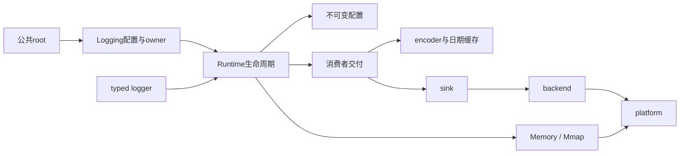

# 代码结构与公共边界

应用接入从 `kron.Logging` 开始，源码从 [src/root.zig](../src/root.zig) 的分组导出开始。根模块保留原有公共名称，内部文件位置可以按职责调整；消费项目通过 `b.dependency` 使用模块，不引用内部路径。

## 模块职责

| 目录/模块 | 职责与拥有的资源 |
| --- | --- |
| [logging/](../src/logging/root.zig) | 应用owner；configuration定义单/多输出与队列选项并前置校验，output持有稳定writer/file/rolling资源，root管理Runtime生命周期，tests验证错误和所有权 |
| [core/logger.zig](../src/core/logger.zig)、field/context/adapter | typed producer、入场前过滤与lazy、显式字段、borrowed/owned context、对象成员选择 |
| [core/runtime.zig](../src/core/runtime.zig) | 稳定Runtime owner，协调admission、queue、配置、worker、flush/control与销毁；集中保护生命周期和重入约束 |
| core/runtime_init、runtime_configuration、runtime_redaction | 初始化/回滚、冷配置/collection、非空脱敏scratch；与producer稳态工作隔离 |
| core/admission、control、thread_registry、prepared、static_owner | 共享/线程gate、deadline任务、线程token/cookie/generation、schema与静态时钟handle |
| core/codec、schema_codec、reference_encoding、wire_size/write | 自包含/引用载荷与历史版本、checked解析、完整树验证/长度统计、共有wire写入 |
| [core/delivery.zig](../src/core/delivery.zig)、delivery_batch | 已固定配置的编码fanout、required written/durable屏障、准确前缀统计与回收 |
| [config/](../src/config/routes.zig) | filter/cache/reload、来源合并与有界JSON、不可变route快照、按需output_policy采样/脱敏/限制、reader/record pins和sink leases |
| [journal/](../src/journal/journal.zig) | Memory/Mmap backing、布局、CRC/generation、reserve/commit/abort/peek/reclaim、schema-ready/checkpoint和独占恢复 |
| [pipeline/](../src/pipeline/predicate.zig) | 采样、递归脱敏、predicate/有界NFA正则、flight recorder |
| [encoder/](../src/encoder/root.zig) | text/JSON/logfmt，共有数字/转义和source路径输出，checked wire/reference融合与fallback |
| [archive/](../src/archive/reader.zig) | 自包含frame、只读Reader/follow、标准zlib压缩 |
| [sink/](../src/sink/interface.zig) | 输出接口、writer/file/rolling/compressed resources、记录边界与错误锁存 |
| [backend/](../src/backend/interface.zig) | portable/io_uring批量写、buffer pool、文件/目录同步与在途所有权 |
| [platform/](../src/platform/capabilities.zig) | Linux/Windows/Darwin mapping与能力、时钟/TSC、CRC专门化 |
| [time/](../src/time/root.zig) | Gregorian日期、exact timestamp/duration、RFC3339、route-owned秒缓存与显式系统local转换 |
| [telemetry/](../src/telemetry/trace_context.zig)、adapters | 显式trace/span关联、std.log桥的绑定与有界producer格式化 |

## 依赖与热路径

图是职责方向；实际源码的类型共享不是严格无环图。例如Runtime与配置/日志类型会共享声明，Zig懒分析支持这些依赖。移动代码不得为打破名义循环而公开私有方法、修改格式或改变owner保护协议。

Logging仅在初始化配置/资源时工作；返回的logger直接持有Runtime或已验证线程/prepared owner。producer接受前复制动态字节，消费者借用checked记录完成渲染。系统local在异步消费者按事件秒转换；源码目录映射在编译期完成。同步/fallback_sync保留调用线程交付。

Runtime协调文件仍较大，因为admission、cut、worker/error、flush/关闭共享同一owner与私有gate。代码拆分优先稳定职责，例如初始化、配置、脱敏、交付和codec；不通过把每个私有方法公开来缩短文件。TSC也保留资格化与回退的一致状态机，后续拆分应保持单独验证能力。

## 测试与构建位置

短模块测试与实现放在一起。较长codec、线程注册和Runtime回归集中到 [core/tests/](../src/core/tests/runtime.zig)，由所属生产模块的 `test` import纳入公共测试，不进入非测试可执行程序。这里只访问已有模块边界，没有为测试新增公开内部状态。

公共集成、并发/故障、compile-fail、独立消费包和进程/子VM测试位于 [tests/](../tests/README.md)。各场景的fixture保持自己的边界；生产路径通过根模块导入验证，避免只分析测试stub。

`build.zig` 定义包模块、公共运行/测试/基准step与复合gate；[build/validation.zig](../build/validation.zig) 归拢九目标生产对象检查及19个示例入口。根 [examples.zig](../examples.zig) 选择字面import并保留仓库相对source路径。`build.zig.zon.paths` 同时包含build支持与入口，源码分发门禁核验独立包。

## 扩展与修改原则

- 常规应用增加选项先放Logging配置层，提交handle保持直接路径。
- 新输出资源在sink/backend边界实现，明确borrowed/owned、required/best_effort、written/durable和失败前缀。
- 新schema/wire版本保持独立校验与旧fixture，Reader恢复不能依赖裸指针。
- 配置/route修改保留旧record身份和pins/leases；filter-only与full replacement分别测试。
- 优化同时测实际成本与相同事件的完整输出，保留fallback、错误优先级与恢复边界。

具体最小测试、最终gate和证据维护见 [development.md](development.md)。
