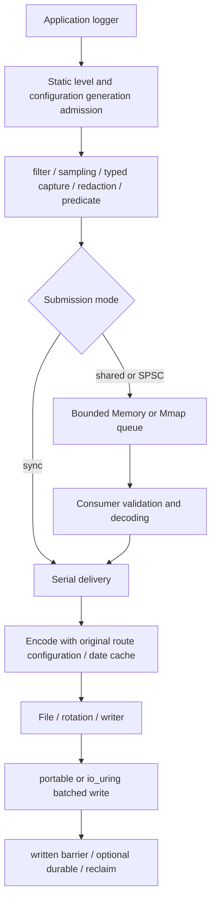

# kron overall design

Toolchain: Zig 0.16. This document describes the current architecture, the
protocols that must not be relaxed, and the complete acceptance requirements.
See the [usage guide](usage.md) for application integration,
[code structure](code-structure.md) for source dependencies, and
[current status](implementation-status.md) for completed evidence and gaps. The
research record behind the original design and the replaced interface drafts are
preserved in [historical design](history/design-2026-10-31.md).

## 1. Goals and boundaries

1. Native Zig structured events, using comptime checks for formats and fields.
2. Reduce producer overhead by moving number formatting, escaping, dates, and
   file I/O to asynchronous consumers.
3. Keep text/JSON directly viewable and collectable; offer logfmt/binary as
   optional formats.
4. Provide process-crash recovery for complete commits with Mmap, and an
   explicitly volatile queue with Memory.
5. Make accepted, written, durable, overload, and disk-error boundaries
   explicit.
6. After initialization and preparation, built-in normal producer paths do not
   call the heap allocator.
7. Give queues, schemas, channels, configuration, output scratch, and in-flight
   I/O explicit budgets that can be observed.
8. Compose clear frontend, configuration, queue, encoder, and sink/backend
   boundaries.

The current scope is single-machine logging on Windows/Linux/macOS/Android/iOS,
with a public Zig interface; network sinks/exporters have been removed.
Implementation, cross-compilation, linking, device execution, and durability
qualification are recorded separately. The runtime does not promise to be
universally fastest on arbitrary hardware, to achieve constant low nanoseconds,
to complete arbitrary I/O in bounded time, or to make Mmap automatically
power-loss safe. Concurrent rotation of the same file by multiple processes,
automatic traversal of arbitrary object graphs, and draining Runtime from signal
handlers are outside the current guarantees.

## 2. Industry references and trade-offs

| Reference | Mechanism adopted | kron boundary |
| --- | --- | --- |
| tracing / Go slog / zap | Structured events, enabled checks first, immutable context, compile-time metadata | Explicit context/trace propagation; one application owner |
| spdlog / Foundation | Sink composition, per-second date caching, direct number generation | Local time is formatted in the consumer; source paths are displayed relative to the project root |
| Quill / fmtlog / NanoLog | Per-thread SPSC, typed argument capture, background formatting | Dynamic bytes are copied before acceptance; thread attachment is explicit |
| Binlog / journaling implementations | Self-contained metadata, CRC, independent reading and recovery | No process pointers are persisted; versions are validated independently |
| OS file/mmap/io_uring | Bounded batches, file identity, write completion and sync | Partial writes/CQE errors preserve the exact prefix; durability is confirmed separately |

See [API architecture](api-design.md) for the concrete tracing responsibility
mapping and [industry optimization reference](industry-performance-lessons.md)
for source mechanisms and performance experiments. Cross-library rankings must
come from same-round measurements with identical workloads and completion
boundaries.

## 3. Event flow



Filter/sampler admission happens before expensive field construction; field
predicates require captured values. Acceptance fixes the configuration
generation and target, and consumers do not re-decide old records against the
latest filter. Mmap records are written directly into the file mapping; a record
cannot first enter a volatile queue and later be moved to a journal while still
claiming that the original acceptance is recoverable.

## 4. Public interface

The unified application entry point is
`kron.Logging.create(allocator, io, options)`. One owner manages the `outputs`
list and rotation; each route has its own Runtime, and
`scoped`/`attachThread`/`prepared` capture fields and time once before
submitting to the selected pipelines. `scopedOutput` provides a direct
single-target path.

```zig
const logging = try kron.Logging.create(allocator, io, .{
    .outputs = &.{
        .{
            .target = .{
                .file = .{
                    .path = "app.jsonl",
                    .backend = .portable,
                },
            },
            .mode = .asynchronous,
            .format = .json,
        },
    },
});
defer logging.destroy();
logging.scoped("app").info("started", .{});
try logging.shutdown();
```

Mode/queue/overflow, sampling, redaction, format, and similar policies are
defined directly on each route; omitted fields use the route defaults. Effective
redaction runs before each queue accepts the value. The default is
stderr/sync/text/info. Async/SPSC default to bounded Memory, Mmap requires an
explicit path, and SPSC requires an explicit thread budget. All targets use the
`outputs` list; each Mmap target needs a stable file identity, while
stdout/writer routes configure independent Memory or sync. The lower-level
Runtime remains for external sinks, complex configuration transactions,
cross-generation recovery, and clock extensions.

Logger `tryEmit`/`tryLogf` return errors and the exact acceptance result;
ordinary void methods report errors through diagnostics. `At` entries pass the
source explicitly; compile-time `source.fromModule` or the root entry point
guarantees project-relative file paths. Text output prints an unquoted
`path:line:column`; control characters remain escaped.

## 5. Events, fields, and context

An event stores level/scope/message, typed fields/format arguments, Unix
nanoseconds, session/channel/sequence, route/configuration identity, and
optional source and trace. The session distinguishes owner run generations, the
channel distinguishes submission queues, and the sequence is allocated by queue
reservation or a synchronous counter; the combined identity correlates outputs
and supports at-least-once replay.

Built-in scalars, optionals, enum/error names, bytes, duration/timestamp, and
explicit arrays/groups are supported. Arbitrary object pointers/graphs are not
traversed automatically; an adapter captures only explicitly selected members.
A top-level event has at most 64 fields, attributes/arguments share an 8-level
and 256-node budget, and cycles, duplicate keys, and budget overruns are rejected
explicitly.

A borrowed context depends on storage covering all logger uses; an owned context
deep-copies the merged parent/child content at initialization and is destroyed
once. Before acceptance, the message, keys, strings/bytes, and nested
descriptors are copied so the consumer does not borrow the producer stack. Merge
order is parent < child < event. A `Secret` original never enters capture.
`Logging` applies per-route redaction before each independent queue; an advanced
Runtime applies global redaction before the shared queue, and route-level
redaction only changes that route's rendering. See [capture](capture.md) and
[structured values](structured-values.md).

## 6. Queue protocol and recovery

Memory and Mmap share fixed slots, sequence/generation, reserve/commit/abort,
CRC, and single-consumer acknowledgement protocols. Mmap uses a platform shared
file mapping; file layout, schema table, and event payload versions are checked
separately. Schema-ready publication follows applicable synchronization, and a
referencing record cannot point to an unready, missing, or corrupt definition.

Consumers deliver checked records and reclaim them after the acknowledgement
barrier. A reserved gap is never treated as a complete event, and crash scanning
still recovers complete commits after a gap. Slot reuse, wrap, watermarks,
checkpoints, and exclusive locks have explicit verification. Unknown versions,
layouts, or target-identity mismatches must fail and preserve the journal.

Recovered records do not depend on the old application binary or raw pointers,
and at-least-once duplication is allowed; stable targets and
session/channel/sequence help deduplication. Durability cannot be inferred from
acceptance, and writing two files is not an atomic transaction. See
[encoding](encoding.md), [schema](schema.md), and
[storage](async-storage.md) for protocol and version details.

## 7. Concurrency, ordering, and thread attachment

Shared-queue producers reserve concurrently, while an SPSC channel is submitted
exclusively by its owning OS thread. Control blocks, token cookie/generation,
scope copies, and configuration caches are established at
initialization/attachment; a stale handle from the wrong thread or after
retirement/reuse is rejected from accessing a new channel.

All channels are preallocated at initialization, and the budget includes the
ordinary shared queue. Detach must run on the owning thread with no outstanding
admission/reservation; channel storage remains for consumer draining, and all
users must stop before Runtime destruction. Tasks that migrate across threads
should use a shared logger.

Shared queues deliver in reservation order; SPSC provides per-channel FIFO, with
no global wall-clock or causal ordering across channels. Synchronous output is
not interleaved, and assigned sequence numbers and lock order do not equal call
time. `fallback_sync` uses a separate channel namespace. Consumer service budget
balances peer fairness and batch locality; safe retirement never relies on
activity guesses.

## 8. Output, files, and io_uring

Encoders share the heavy logic, and the typed frontend does not duplicate the
complete JSON algorithm at every call site. Within an advanced Runtime, adjacent
targets with the same format/time reuse encoding; independent `Logging`
pipelines copy and render separately. Fast wire/reference paths must preserve
the complete checked boundary and fallback. File output serially manages
explicit offsets, staging, and in-flight buffers.

Portable and io_uring both guarantee complete batch writes; CQE completion,
short writes/zero progress, errors, buffer leases, and shutdown are handled
explicitly. A successful SQE submission is not `written`; flush must wait for
user-space buffers and in-flight I/O. When a platform capability such as
directory durability is unavailable, durable is rejected explicitly. Automatic
backend selection and actual-backend reporting are separate; see
[file reliability](file-reliability.md).

## 9. Dynamic configuration and policy

The default filter supports a global threshold and longest-component scope
matching; independent route filters form a union of acceptance. Initialization
and reload parse text, and producers do not read the environment or
configuration files. Compile-time levels and enabled/lazy checks avoid expensive
construction; ordinary function arguments are still evaluated first.

Defaults < file < environment < explicit are merged and published once as an
immutable configuration. Old admissions/accepted records hold their generation
and sink lease, so records still go to the original target after replacement.
Filter-only updates preserve sampler phase; a full replacement creates new
policy state. Configuration slot/metadata budget exhaustion and OOM preserve the
current version, and resources are released after collection confirms old
references and barriers. See [configuration](configuration.md),
[predicates](predicates.md), and [sampling](sampling.md).

## 10. Completion, deadlines, and shutdown

Accepted means submission succeeded, written means required outputs were fully
written, and durable additionally performs supported output synchronization and
applicable journal checkpoints. Durability of a subset of outputs does not
declare other targets or the global journal durable.

Flush establishes an admission cut that includes events already being captured
but not yet reserved; completion cannot be inferred from a momentarily empty
queue. Deadlines use a monotonic clock and include waiting for control slots,
the cut, consumers, and sink barriers. A timeout stops only the wait; it does
not cancel published work, all resources remain alive, and destroy still blocks.

Shutdown order: stop producers and join/detach, unbind `std.log`, flush/durable
as needed, shutdown, destroy `Logging` or Runtime/sink, and finally clean up
application I/O. Reentrant control and destruction from submit/sink/worker/
diagnostic paths are forbidden; shutdown errors are latched and can be observed
repeatedly. Single-threaded builds support only sync and ordinary
flush/shutdown; async and timed interfaces return explicit capability errors.
See [lifecycle](lifecycle.md).

## 11. Backpressure and observability

A full queue is handled by block/drop_newest/fallback_sync: wait for space,
reject the new event, or deliver synchronously on the calling thread.
Shutdown/worker errors must wake waiting producers. Sampling is a shared budget
for all producers within a configuration generation; by default warn and above
bypass only sampling, not filter/predicate.

Health observes accepted/written, filtered/sampled/drop, capture/write/flush/sync
errors, pending/high-water/recovered, actual storage/budget/channel, and state.
Individual atomics are not a transactional snapshot; exact end-state
verification stops users and completes shutdown first. Diagnostics are merged
within a bound, and hooks run outside internal locks to prevent recursion and
error storms from creating unbounded work.

## 12. Encoding, archives, rotation, and tools

Text is readable, JSON preserves structure and types, logfmt uses uniform
key/value pairs, and binary uses versioned self-contained frames. String
escaping stays single-line, invalid UTF-8 and key encoding have explicit rules,
and short buffers/field errors never report success.

Rotation checks complete-record size and an optional monotonic time interval,
preserving target identity across retention/reopen/sync and failure paths.
Compressed archives use standard zlib framing, and `kroncat` supports read-only
export, queries, follow, and journal inspection; all versions and CRCs are
validated. See [encoding](encoding.md),
[archive](compressed-archive.md), and [tools](../tools/README.md).

## 13. Time, trace, and std.log

Events store real Unix nanoseconds, while deadlines/rotation/sampling use an
independent monotonic clock. UTC and fixed-minute offsets are pure Zig; explicit
system local time uses platform rules/DST, caches within a second, refreshes
across seconds/backward jumps, and formats in the asynchronous consumer. The
system timezone configuration must remain stable at runtime, and source identity
enters the Mmap recovery fingerprint; no IANA database is bundled. See
[time](time.md) and [TSC](tsc-clock.md).

TraceContext propagates explicitly by value, and Span is used for local
correlation; there is no automatic task inheritance or ID generation. The
`std.log` bridge integrates through root `std_options` and bind/unbind, uses
bounded producer preformatting, and keeps its cost separate from the typed
deferred path.

## 14. Directories and dependencies

The public `src/root.zig` groups APIs by responsibility and preserves original
names. `logging/` owns application configuration/resources/lifetime, `core/`
coordinates frontend/codec/Runtime, `config/` manages generations and policies,
`journal/` manages storage protocols, `encoder/` renders, and
`sink/backend/platform/` isolates I/O and platform behavior.

Module tests sit next to their implementation or in `core/tests/`; public
integration/fault tests are under `tests/`. Build support lives in `build/`, and
examples preserve source paths from the repository-root entry point. The
distribution manifest includes every module. See
[code structure](code-structure.md) for the source graph, private boundaries,
and independent verification entries.

## 15. Verification and performance gates

### 15.1 Correctness

| Scope | Core tests |
| --- | --- |
| Fields/comptime | Supported types, optionals, enum/error, invalid pointers, duplicate keys, invalid formats |
| Encoder | Golden output, control characters, UTF-8, NaN/Inf, integer boundaries, parseable JSON per line |
| Context | Parent/child override, owned deep copy, source-slice overwrite after submission does not change output |
| Redaction | Secrets never enter the journal, field-policy snapshots, explicit message boundaries |
| Allocation | Counting or failing allocator verifies built-in hot paths after initialization/warmup |
| Journal | reserve/commit/reuse, generation, wrap, schema ordering, capacity boundaries |
| Crash | SIGKILL injected at every commit/checkpoint/I/O step; complete events recover |
| MPSC gaps | One producer reserves and stops; later committed events still recover after a crash |
| Concurrency | 1/N producers, no duplicate corruption, SPSC thread ownership, detach/shutdown |
| I/O faults | Partial/zero writes, ENOSPC, sync errors, out-of-order CQEs, rotation failures |
| Filter | Longest scope, component boundaries, route union, atomic reload, old-event decisions |
| Flush | Snapshot boundaries, concurrent flush, in-flight writes, durable dependencies |
| Shutdown | Block wakeups, double shutdown, resources valid after deadline, worker self-lock |
| Recovery tools | Decoding without the old binary, unknown schema/version, bad tail, duplicate reports |

SIGKILL tests are not power-loss tests. Durability guarantees require dedicated
verification through virtual-machine/block-device fault injection, with the
filesystem, kernel, and storage configuration recorded.

The optional [failure handler](failure-handler.md) is diagnostic evidence for
fatal signals and opt-in fatal events. It writes a separate crash file, does not
drain the logging runtime, and does not replace journal recovery or durable
output boundaries.

### 15.2 Performance

The following must be reported together:

- Producer latency: p50/p99/p99.9, with single-record and batch-average
  measurements separated.
- Encoding throughput: text/JSON with field counts and string sizes.
- Written throughput: includes the final drain, not only time to submit into a
  fast queue.
- Durable throughput/latency: sync policy measured independently.
- Saturation: actual acceptance, drops, blocking time, backlog age, and recovery
  volume.
- Business impact: application throughput, CPU, cache misses, and scheduling
  contention compared with a no-logging baseline.
- Resources: journal bytes, per-thread channels, backend buffers, binary size,
  and compile time.

Scenarios include filtered, 0/5/10 fields, numbers/short strings/long strings,
1/4/16 producers, warm/cold cache, burst/sustained overload, slow/failing sinks,
frequent thread creation/destruction, reload, and rolling.

When comparing kron with spdlog, Quill, fmtlog, NanoLog, Binlog, and similar
libraries, keep the message, output format, clock, queue/memory budget, drop
policy, final drain, and durability boundary fixed. Tests that cannot be aligned
are reported separately; binary throughput cannot be used to rank text output.

The repository no longer ships cross-library C++/Rust reference harnesses or
their measured evidence. Current acceptance therefore focuses on reproducible
in-repository end-to-end measurements: complete JSON output, shared/SPSC,
Memory/Mmap, P1/P4, and batch/sampled, with written flush, shutdown,
initialization, full lifecycle, and p99/p99.9 reported separately. The default
CRC and recovery protocols remain enabled; the optional Memory CRC opt-out is
reported separately. A group is considered ahead only when paired rounds are
complete, both sides and the ratio pass the stability budget, and the interval
demonstrates a lead; a local result cannot replace full acceptance.

Baseline goals: built-in hot paths make zero allocator calls; scope filtering is
a small number of atomic reads/comparisons in steady state; a low-latency
producer does not format, perform per-record system calls, or contend on a
global submission lock. Mmap faults and backpressure costs are reported
separately.

Absolute nanosecond/throughput targets are established on fixed machines after
implementation. Once a stable baseline exists, use a 5%–10% regression threshold
in the same environment; noise and insufficient samples must not be mistaken for
optimization gains.

## 16. Follow-up delivery and qualification

The main functionality is implemented. The final goals are advanced item by item
against current status: stable complete performance advantages, tail/backpressure
impact on applications, Mmap startup and retention cost, business/durable
matrices, long-running fuzz and upgrade combinations, more filesystem/device
faults, and real execution on non-Linux platforms. Historical experiment
rejections and negative data remain part of the record; the existence of a
feature does not replace the corresponding qualification.

Development starts with the smallest relevant verification, then escalates to
the full gate according to impact. Before release, independent package/source
distribution, single-threaded builds, and target platforms each need their own
evidence. Performance comparisons do not change event/output/recovery semantics
to claim an equivalent optimization. See [development](development.md) and
[remaining priorities](implementation-status.md#priority-of-remaining-work).

## 17. References

### Multi-language

- [Rust tracing](https://docs.rs/tracing/latest/tracing/)
- [tracing callsite](https://docs.rs/tracing-core/latest/tracing_core/callsite/)
- [tracing EnvFilter](https://docs.rs/tracing-subscriber/latest/tracing_subscriber/filter/struct.EnvFilter.html)
- [Go slog design](https://go.dev/blog/slog)
- [Go zap](https://pkg.go.dev/go.uber.org/zap)
- [Go zerolog](https://github.com/rs/zerolog)
- [Log4j2 async logging](https://logging.apache.org/log4j/2.x/manual/async.html)
- [Log4j2 performance](https://logging.apache.org/log4j/2.x/manual/performance.html)
- [Logback appenders](https://logback.qos.ch/manual/appenders.html)
- [Python logging cookbook](https://docs.python.org/3/howto/logging-cookbook.html)
- [Serilog](https://serilog.net/)
- [OpenTelemetry Logs Data Model](https://opentelemetry.io/docs/specs/otel/logs/data-model/)

### C++ high-performance logging

- [spdlog](https://github.com/gabime/spdlog)
- [spdlog async wiki](https://github.com/gabime/spdlog/wiki/6.-Asynchronous-logging)
- [PlatformLab NanoLog](https://github.com/PlatformLab/NanoLog)
- [NanoLog USENIX ATC 2018 paper](https://www.usenix.org/conference/atc18/presentation/yang-stephen)
- [Quill](https://github.com/odygrd/quill)
- [Quill timestamp types](https://quillcpp.readthedocs.io/en/latest/timestamp_types.html)
- [Quill comparison benchmarks](https://github.com/odygrd/logger_benchmarks)
- [fmtlog](https://github.com/MengRao/fmtlog)
- [Morgan Stanley Binlog](https://github.com/morganstanley/binlog)
- [Binlog internals](https://morganstanley.github.io/binlog/Internals.html)
- [Reckless](https://github.com/mattiasflodin/reckless)
- [Reckless performance methodology](https://github.com/mattiasflodin/reckless/blob/master/doc/performance.md)
- [XTR API and io_uring storage](https://choll.github.io/xtr/api.html)
- [Tencent BqLog](https://github.com/Tencent/BqLog)

### Operating systems and Zig

- [Linux mmap](https://man7.org/linux/man-pages/man2/mmap.2.html)
- [Linux msync](https://man7.org/linux/man-pages/man2/msync.2.html)
- [Linux fsync](https://man7.org/linux/man-pages/man2/fsync.2.html)
- [Linux posix_fallocate](https://man7.org/linux/man-pages/man3/posix_fallocate.3.html)
- [Linux io_uring](https://man7.org/linux/man-pages/man7/io_uring.7.html)
- [io_uring fsync](https://man7.org/linux/man-pages/man3/io_uring_prep_fsync.3.html)
- [Zig 0.16 documentation](https://ziglang.org/documentation/0.16.0/)
- [Zig 0.16 release notes](https://ziglang.org/download/0.16.0/release-notes.html)
