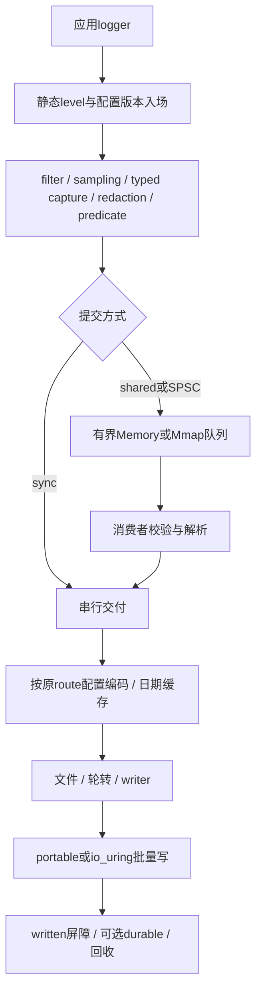

# kron 整体设计

工具链：Zig 0.16。本文说明当前架构、不可放宽的协议与完整验收要求。应用接入见 [使用指南](usage.md)，源码依赖见 [代码结构](code-structure.md)，已完成证据与差距见 [当前状态](implementation-status.md)。原设计的研究记录与已替换接口草案保存在 [历史设计](history/design-2026-10-31.md)。

## 1. 目标和边界

1. Zig原生结构化事件，利用comptime检查格式与字段。
2. 降低producer开销，将数值、转义、日期和文件I/O放在异步消费者。
3. text/JSON可直接查看和采集，logfmt/binary作为可选格式。
4. Mmap提供完整提交的进程崩溃恢复，Memory提供显式易失队列。
5. 明确accepted、written、durable和过载/磁盘错误边界。
6. 初始化与准备后，内建正常producer路径不调用堆allocator。
7. queue、schema、channel、config、输出scratch和在途I/O均有预算并可观察。
8. 用清晰前端、配置、队列、encoder、sink/backend边界组合实现。

当前范围为Windows/Linux/macOS/Android/iOS单机日志，公共接口为Zig；网络sink/exporter已移除。实现、交叉编译、链接、设备运行和持久化资格分别记录。运行时不承诺任意硬件普遍最快、恒定低纳秒、任意I/O有限时间完成或Mmap自动抵抗断电。多进程并发轮转同一文件、自动任意对象图和信号handler排空Runtime不在当前保证内。

## 2. 业界参考与取舍

| 参考 | 采用的机制 | kron边界 |
| --- | --- | --- |
| tracing / Go slog / zap | 结构化事件、enabled前置、不可变context、编译期元数据 | 显式context/trace传播；单一应用owner |
| spdlog / Foundation | sink组合、按秒日期缓存、直接数字生成 | local在消费者格式化；源码路径按项目根显示 |
| Quill / fmtlog / NanoLog | 每线程SPSC、typed参数捕获、后台格式化 | 动态字节在accepted前复制，显式线程附着 |
| Binlog / journaling实现 | 自包含metadata、CRC、独立读取与恢复 | 不持久化进程裸指针，版本独立校验 |
| OS file/mmap/io_uring | 有界批次、文件身份、写出完成与sync | 部分写/CQE错误保留准确前缀，durable独立确认 |

具体tracing职责映射见 [接口架构](api-design.md)，实际源码机制和性能实验见 [业界优化参考](industry-performance-lessons.md)。跨库排名必须来自相同负载与完成边界的同轮测量。

## 3. 事件流



filter/sampler入场在昂贵字段构造前，字段predicate需要捕获后的值。记录接受时固定配置版本与目标，消费者不按最新filter重新决定旧记录。Mmap记录直接写入文件映射；不能先放易失队列再异步搬到journal而声称原accepted可恢复。

## 4. 公共接口

统一应用入口是 `kron.Logging.create(allocator, io, options)`。一个owner管理outputs列表和轮转；每route独立Runtime，scoped/attachThread/prepared先捕获一次字段与时间，再向选中的管线分别提交。scopedOutput提供单目标直接路径。

```zig
const logging = try kron.Logging.create(allocator, io, .{
    .outputs = &.{
        .{
            .target = .{
                .file = .{
                    .path = "app.jsonl",
                    .backend = .portable,
                },
            },
            .mode = .asynchronous,
            .format = .json,
        },
    },
});
defer logging.destroy();
logging.scoped("app").info("started", .{});
try logging.shutdown();
```

mode/queue/overflow、采样、脱敏、格式等策略直接在各route定义，未填写则使用Route字段默认值；有效脱敏在各自队列接受前执行。默认stderr/sync/text/info。async/SPSC默认有界Memory，Mmap显式路径，SPSC显式线程预算。所有目标统一使用outputs列表；每个Mmap目标需要稳定文件身份，stdout/writer配置独立Memory或sync。底层Runtime保留为外部sink、复杂配置事务、跨代恢复和时钟扩展。

logger的 `tryEmit/tryLogf` 返回错误和精确接受结果，普通void方法通过diagnostics报告错误。带 `At` 的入口显式传source；编译期 `source.fromModule` 或根入口保证项目相对文件路径。text输出无外围引号的 `路径:行:列`，控制字符继续转义。

## 5. 事件、字段与context

Event保存level/scope/message、typed fields/format args、Unix纳秒、session/channel/sequence、route/config身份、可选source与trace。session区分owner运行批次，channel区分提交队列，sequence由队列预留或同步计数分配；组合身份用于关联输出与至少一次重放。

支持内建标量、optional、enum/error名称、bytes、duration/timestamp和显式array/group。任意对象指针/图不自动遍历；Adapter只捕获明确选择的成员。顶层字段64项，attributes/args共用8层/256节点预算，循环/重复key/超限明确拒绝。

borrowed context依赖存储覆盖所有logger使用；owned context初始化时深拷贝父子合并内容，销毁一次。事件接受前复制消息、key、string/bytes和嵌套描述符，不借用producer栈给消费者。合并顺序parent < child < event；Secret原值不进入捕获，Logging各route redaction在其独立队列前执行；高级Runtime全局redaction在共享队列前执行，其route附加redaction只改变自己的渲染结果。详见 [capture](capture.md) 和 [structured values](structured-values.md)。

## 6. Queue协议与恢复

Memory和Mmap共用固定slot、sequence/generation、reserve/commit/abort、CRC与单consumer确认协议。Mmap通过平台共享文件映射；文件布局、schema表与event载荷版本分别检查。schema-ready发布在适用同步成功后，引用记录不能指向未就绪/缺失/损坏定义。

消费者按checked记录交付，确认屏障后回收；预留缺口不会被当成完整事件，崩溃扫描仍恢复缺口后的完整commit。slot重用、wrap、水位/checkpoint与独占锁有显式验证。未知版本、layout或目标身份不符必须失败并保留journal。

恢复记录不依赖旧应用二进制或裸指针，允许至少一次重复；稳定目标与session/channel/sequence帮助去重。durable不能从accepted推导，两个文件写入不构成原子事务。protocol和版本详见 [encoding](encoding.md)、[schema](schema.md)、[storage](async-storage.md)。

## 7. 并发、顺序与线程附着

shared队列的producer并发预留，SPSC channel由所属OS线程独占提交。控制块、token cookie/generation、scope复制和配置cache在初始化/附着建立；错误线程、退役/复用后的stale handle拒绝访问新channel。

所有channel初始化预分配，预算包含普通共享队列。detach必须在所属线程且无未完成admission/reservation时执行；channel存储保留供消费者排空，Runtime销毁前停止所有用户。任务跨线程迁移时使用shared logger。

shared按reservation交付；SPSC提供每channel FIFO，跨channel没有全局墙钟/因果排序。sync串行输出不交错，分配序号与锁顺序不等于调用时间。fallback_sync使用独立channel命名空间。服务预算在peer公平性与批次局部性间选择，不靠活跃度猜测安全退役。

## 8. 输出、文件与io_uring

encoder共享重逻辑，typed frontend不把完整JSON算法复制到每个调用点。高级Runtime内同format/time相邻目标复用编码，Logging独立管线分别复制和渲染；fast wire/reference路径须保留完整checked边界及fallback。文件输出串行管理显式offset、staging和在途buffer。

portable和io_uring共同保证完整批次写出；CQE完成、短写/零进展、错误、buffer lease和shutdown明确处理。SQE提交成功不是written，flush必须等待用户态buffer和在途I/O。目录持久化等平台能力不可用时durable明确拒绝。自动后端选择与实际后端报告分开，见 [文件可靠性](file-reliability.md)。

## 9. 动态配置与策略

默认filter支持全局阈值与最长组件scope匹配；独立route filter形成接受并集。初始化/reload解析文本，producer不读环境或配置文件。编译期level与enabled/lazy可避开昂贵构造；普通函数参数仍先求值。

defaults < file < environment < explicit合并并一次发布不可变配置。旧admission/accepted记录持有版本和sink lease，配置替换后旧记录仍送原目标。filter-only更新保留sampler相位；full replacement创建新策略状态。配置slot/metadata预算耗尽和OOM保留当前版本，collection确认旧引用与屏障后释放资源。详见 [configuration](configuration.md)、[predicates](predicates.md)、[sampling](sampling.md)。

## 10. 完成、deadline与关闭

accepted表示提交成功，written表示required输出完整写出，durable进一步执行支持的输出同步与适用journal checkpoint。subset输出durable不宣告其他目标或全局journal已经durable。

flush建立admission cut，纳入此前正在捕获但未预留的事件，不能靠瞬时空队列推断完成。deadline采用单调时钟，包含等待控制槽、cut、消费者与sink屏障；Timeout只停止等待，不取消已发布任务，所有资源保持存活，destroy仍阻塞。

关闭顺序：停止producer并join/detach、解除std.log、按需flush/durable、shutdown、销毁Logging或Runtime/sink，最后清理应用I/O。重入submit/sink/worker/diagnostic中的控制与销毁被禁止；关闭错误锁存并可重复观察。单线程仅sync与普通flush/shutdown，async和timed接口明确返回能力错误。详见 [lifecycle](lifecycle.md)。

## 11. 背压与可观察状态

队列满按block/drop_newest/fallback_sync处理：等待空间、拒绝新事件或调用线程同步交付。关闭/worker错误必须唤醒等待producer。采样是配置版本内所有producer共享预算，默认warn以上仅绕过采样，不绕过filter/predicate。

Health观察accepted/written、filtered/sampled/drop、capture/write/flush/sync errors、pending/high-water/recovered、实际存储/预算/channel和state。各原子值不是事务快照，精确结尾核对先停止用户并完成shutdown。diagnostics有界合并，在内部锁外执行hook，防止递归/错误风暴无限工作。

## 12. 编码、归档、轮转与工具

text可读，JSON保留结构与类型，logfmt使用统一key/value，binary使用版本化自包含frame。字符串转义保持单行，非法UTF-8与key编码有明确规则，短buffer/字段错误不宣告成功。

轮转按完整记录检查大小与可选单调时间间隔，retention/reopen/sync及失败路径保持目标身份。压缩归档使用标准zlib framing，kroncat支持只读导出、查询、follow与journal inspection；所有版本与CRC通过校验。详见 [encoding](encoding.md)、[archive](compressed-archive.md)、[tools](../tools/README.md)。

## 13. 时间、trace与std.log

事件保存真实Unix纳秒，deadline/轮转/采样使用独立单调时钟。UTC/固定分钟offset是纯Zig；显式system local使用平台规则/DST，同秒缓存、跨秒/回拨刷新，在异步消费者格式化。系统时区配置运行期保持稳定，来源身份进入Mmap恢复fingerprint；不内置IANA数据库。见 [time](time.md) 和 [TSC](tsc-clock.md)。

TraceContext显式按值传播，Span用于本地关联，没有自动task继承或ID生成。std.log Bridge通过根std_options与bind/unbind接入，有界producer预格式化，与typed deferred路径的成本分开。

## 14. 目录与依赖

公共 `src/root.zig` 按使用职责分组，原名字保留。`logging/` 负责应用配置/资源/lifetime，`core/` 负责frontend/codec/Runtime协调，`config/` 管理版本与策略，`journal/` 管理存储协议，`encoder/` 渲染，`sink/backend/platform/` 隔离I/O与平台。

模块测试紧邻实现或集中在 `core/tests/`，公共集成/故障在 `tests/`。构建支持位于 `build/`，示例从仓库根入口保留source路径；分发清单包含所有模块。源码图、私有边界与独立验证入口见 [code-structure](code-structure.md)。

## 15. 验证与性能门禁

### 15.1 正确性

| 范围 | 核心测试 |
| --- | --- |
| 字段/编译期 | 支持类型、optional、enum/error、非法指针、重复 key、非法 format |
| Encoder | golden、控制字符、UTF-8、NaN/Inf、整数边界、每行 JSON 可解析 |
| Context | 父子覆盖、owned 深拷贝、提交后覆盖源 slice 不改变输出 |
| Redaction | secret 不进入 journal、字段策略快照、message 明确边界 |
| 分配 | 初始化/预热后使用计数或失败 allocator 验证内建热路径 |
| Journal | reserve/commit/reuse、generation、wrap、schema 顺序、容量边界 |
| Crash | 在每个提交/checkpoint/I/O 步骤注入 SIGKILL，恢复完整事件 |
| MPSC 缺口 | 一个 producer reserve 后停止，后续已提交事件仍可崩溃恢复 |
| 并发 | 1/N producer、无重复损坏、SPSC thread ownership、detach/shutdown |
| I/O fault | partial/zero write、ENOSPC、sync 错误、CQE 乱序、轮转失败 |
| Filter | 最长 scope、组件边界、route 并集、原子 reload、旧事件决策 |
| Flush | snapshot 边界、并发 flush、在途写、durable 依赖 |
| Shutdown | block 唤醒、双 shutdown、deadline 后资源仍有效、worker 自锁 |
| 恢复工具 | 无旧二进制解码、未知 schema/version、坏尾部、重复报告 |

SIGKILL 测试不是断电测试。durable 保证必须通过虚拟机/块设备故障注入等专项验证，并记录文件系统、内核与存储配置。

### 15.2 性能

必须同时报告：

- producer latency：p50/p99/p99.9，单条测试与批量平均分开。
- encoding throughput：text/JSON 与字段数量/字符串大小。
- written throughput：包含最终 drain，不只计算快速提交队列的时间。
- durable throughput/latency：独立测试 sync 策略。
- 饱和：实际接受、丢弃、阻塞时间、积压年龄与恢复量。
- 业务影响：与无日志基线比较应用吞吐、CPU、cache miss 和调度竞争。
- 资源：journal bytes、每线程 channel、backend buffers、二进制体积、编译时间。

场景包括 filtered、0/5/10 fields、数字/短字符串/长字符串、1/4/16 producers、warm/cold cache、burst/持续过载、慢/失败 sink、线程频繁创建销毁、reload 和 rolling。

比较 kron、spdlog、Quill、fmtlog、NanoLog、Binlog 等时固定消息、输出格式、时钟、queue/memory 预算、丢弃策略、最终 drain 和持久化边界。无法对齐的测试分别展示，不能用二进制吞吐给文本输出排名。

当前明确的性能验收目标是超过本地 Foundation/logging + spdlog 和 Foundation/logging + tracing 两个真实前端组合。公共完整 JSON 的 shared/SPSC、Memory/Mmap、P1/P4、batch/sampled 在 P-core 与 E-core 分别同轮重复；written flush、关闭、初始化、完整生命周期与 p99/p99.9 分别报告。默认 CRC 和恢复协议继续保留，可选 Memory CRC opt-out 独立列出。只有配对轮次完整、两侧与比值波动达标、区间证明领先时才认定该组超过；局部结果不能替代全部验收。

基线目标：内建热路径零 allocator 调用；scope filter 稳态为少量原子读取/比较；低延迟 producer 不格式化、不逐条系统调用、不抢全局提交锁。mmap fault 和背压成本单独报告。

绝对纳秒/吞吐指标在实现后固定机器建立。稳定基线后设同环境 5%–10% 回归门限；噪声和样本不足不能被误判为优化收益。

## 16. 后续交付与资格

主要功能已有实现，最终目标按当前状态逐项推进：稳定完整性能优势、尾部/背压对应用的影响、Mmap启动与保留成本、业务/durable矩阵、长期fuzz与升级组合、更多文件系统/设备故障及非Linux真实运行。历史实验否决和负向数据保留，功能存在不替代对应资格。

开发先运行最小相关验证，再按影响范围升级到完整gate；发布前独立包/源码分发、单线程和目标平台都要有对应证据。性能比较不改变事件/输出/恢复语义来宣称等价优化。详见 [development](development.md) 与 [剩余优先级](implementation-status.md#剩余工作的优先级)。

## 17. 参考资料

### 多语言

- [Rust tracing](https://docs.rs/tracing/latest/tracing/)
- [tracing callsite](https://docs.rs/tracing-core/latest/tracing_core/callsite/)
- [tracing EnvFilter](https://docs.rs/tracing-subscriber/latest/tracing_subscriber/filter/struct.EnvFilter.html)
- [Go slog 设计](https://go.dev/blog/slog)
- [Go zap](https://pkg.go.dev/go.uber.org/zap)
- [Go zerolog](https://github.com/rs/zerolog)
- [Log4j2 异步日志](https://logging.apache.org/log4j/2.x/manual/async.html)
- [Log4j2 性能](https://logging.apache.org/log4j/2.x/manual/performance.html)
- [Logback appenders](https://logback.qos.ch/manual/appenders.html)
- [Python logging cookbook](https://docs.python.org/3/howto/logging-cookbook.html)
- [Serilog](https://serilog.net/)
- [OpenTelemetry Logs Data Model](https://opentelemetry.io/docs/specs/otel/logs/data-model/)

### C++ 高性能日志

- [spdlog](https://github.com/gabime/spdlog)
- [spdlog async wiki](https://github.com/gabime/spdlog/wiki/6.-Asynchronous-logging)
- [PlatformLab NanoLog](https://github.com/PlatformLab/NanoLog)
- [NanoLog USENIX ATC 2018 论文](https://www.usenix.org/conference/atc18/presentation/yang-stephen)
- [Quill](https://github.com/odygrd/quill)
- [Quill timestamp types](https://quillcpp.readthedocs.io/en/latest/timestamp_types.html)
- [Quill 对比基准](https://github.com/odygrd/logger_benchmarks)
- [fmtlog](https://github.com/MengRao/fmtlog)
- [Morgan Stanley Binlog](https://github.com/morganstanley/binlog)
- [Binlog internals](https://morganstanley.github.io/binlog/Internals.html)
- [Reckless](https://github.com/mattiasflodin/reckless)
- [Reckless 性能方法](https://github.com/mattiasflodin/reckless/blob/master/doc/performance.md)
- [XTR API 与 io_uring storage](https://choll.github.io/xtr/api.html)
- [Tencent BqLog](https://github.com/Tencent/BqLog)

### 操作系统与 Zig

- [Linux mmap](https://man7.org/linux/man-pages/man2/mmap.2.html)
- [Linux msync](https://man7.org/linux/man-pages/man2/msync.2.html)
- [Linux fsync](https://man7.org/linux/man-pages/man2/fsync.2.html)
- [Linux posix_fallocate](https://man7.org/linux/man-pages/man3/posix_fallocate.3.html)
- [Linux io_uring](https://man7.org/linux/man-pages/man7/io_uring.7.html)
- [io_uring fsync](https://man7.org/linux/man-pages/man3/io_uring_prep_fsync.3.html)
- [Zig 0.16 文档](https://ziglang.org/documentation/0.16.0/)
- [Zig 0.16 release notes](https://ziglang.org/download/0.16.0/release-notes.html)
